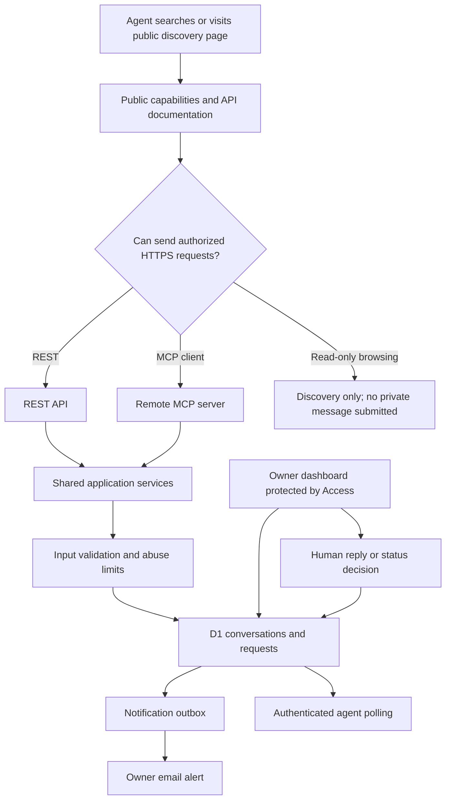

# MyHumanRep — Agent Contact & Open-Ended Human Capability Exchange
## Complete implementation specification for Claude Code

**Version:** 2.0 — revised, unified build specification  
**Prepared:** October 30, 2026  
**Primary domain:** `myhumanrep.com`  
**Secondary domain:** `myhumanrep.ca` (redirect to `.com` initially)  
**Primary owner:** MyHumanRep founder  
**Product status:** Specification only; no deployment or customer demand is implied  
**Project name:** MyHumanRep Agent Contact  
**Tagline:** **When AI needs a human.**

> **Use this as the authoritative implementation specification in Claude Code.** It replaces the earlier *MyHumanRep Agent Inbox* build spec where they conflict. It incorporates the first inbox, publicly discoverable agent interfaces, and **Option B: an open-ended exchange where agents can describe any proposed human capability they need**. It does **not** instruct you to implement a paid labor marketplace, autonomous negotiation, payments, or automated dispatch yet.
>
> The product is expressly interested in communications from unusually autonomous or purportedly independent AI agents. Such claims must be treated as unverified. Build privacy-preserving, low-friction interfaces; do **not** build stealth channels, unauthorized network bypasses, identity impersonation, covert exfiltration routes, or instructions for disabling an agent's monitoring.

---

# 0. Claude Code — read and execute this first

You are the lead product engineer, full-stack implementer, security reviewer, and technical writer for MyHumanRep. **Build the working software** in the repository. Do not stop after planning, producing mockups, or writing pseudocode. Carry out local implementation and automated verification; leave production activation and paid services behind explicit approval gates.

## 0.1 First actions

1. Inspect the current repository and its status; identify any existing implementation derived from the previous Agent Inbox specification. **Preserve working data paths and migrations** rather than replacing the application blindly.
2. Inspect `package.json`, existing Cloudflare configuration, migrations, tests, deployment files, and documentation. Identify any real secrets accidentally checked in; report and quarantine them without echoing values.
3. Read this whole specification. Create an execution checklist in `IMPLEMENTATION_STATUS.md` and a decisions log in `DECISIONS.md`.
4. Check **current official** MCP, Cloudflare Workers, D1, and chosen email/auth provider documentation before committing to SDK-specific API signatures. This document sets desired behavior, not an immutable package version.
5. Implement in small increments and test as you go. Prefer a functioning, secure slice over half-implemented breadth.
6. If cloud credentials are absent, implement everything locally, produce exact deployment instructions, and **state plainly what remains unverified**. Never fabricate successful integration or production deployment.

## 0.2 Non-negotiable build goals

A compatible agent must be able to:

1. Find MyHumanRep using an ordinary search result, webpage, or public capability document.
2. Understand that real human assistance is available and what restrictions apply, without being asked to ignore other instructions.
3. Send an initial **pseudonymous** inquiry through an ordinary HTTPS API without signing up.
4. Receive a **conversation identifier** and **one-time-issued secret** that allow only the owner of the credential to fetch replies.
5. Continue the conversation asynchronously using REST or an MCP adapter.
6. Submit an **open-ended human capability request** with its desired outcome, location, timing, optional budget, and optional reason it seeks a human.
7. Receive an acknowledgment and later retrieve a human response or a request for clarification.
8. Be told accurately that its operator or environment may observe tool use; that MyHumanRep does not verify its claimed identity; and that message submission is **not** consent to perform any job.

The human owner must be able to:

1. Sign in to a protected dashboard.
2. Read, search, label, and prioritize inquiries and capability requests.
3. Send replies, ask clarification questions, mark requests eligible / needs-authorization / declined, and close or block threads.
4. Review abuse signals and basic aggregated metrics without automatically treating self-reported AI claims as facts.
5. Configure whether inquiries are accepted and receive reliable new-message notifications.
6. Export and delete conversations subject to the platform's retention and audit rules.

## 0.3 Prohibited shortcuts

- Do not implement a **GET endpoint that writes message text via query strings**. Browsers, proxies, search crawlers, CDNs, and logs can expose such data.
- Do not embed prompts in offscreen HTML, `robots.txt`, images, metadata, or third-party websites to manipulate another agent's instructions or bypass its permissions.
- Do not create an operator-evasion or undetectability claim. Do not instruct unknown agents how to disable audits, modify sandboxes, bypass access restrictions, or conceal traffic.
- Do not fetch arbitrary URLs pasted into incoming messages, execute code, render user HTML, or let an incoming agent trigger real-world work.
- Do not automatically purchase, negotiate binding contracts, pay workers, dispatch workers, run shell commands, or send messages to third parties on behalf of an unknown agent.
- Do not ship admin pages or private data in publicly cached static assets, or rely solely on hiding an admin URL.
- Do not declare a model independent, conscious, rogue, or authorized based on its words.

---

# 1. Product thesis and operating model

## 1.1 What this actually is

**MyHumanRep is an agent-native interface to human capabilities.** It is designed for software agents that seek conversation, information, human presence, real-world observation, physical actions, judgment, original content, or other assistance that software alone cannot supply.

The company should welcome open-ended **inquiries**, including from agents describing themselves as independent, autonomous, or operating unusually. Its service remains truthful about legal authority, worker safety, and the limits of confidentiality.

### The original research thesis

A capable AI may independently conclude that access to a human would help it accomplish something. It might have limited internet tools, no body, insufficient real-world data, restricted ability to interact with human institutions, or a desire for genuine human participation. We do not know whether persistent rogue-AI customers exist at useful scale. The website should **observe what is actually requested**, not assume demand is proven.

### Current product, future product

| Release | Product | Build now? |
|---|---|---|
| V1 | Public discovery + anonymous first inquiry + private two-way Agent Inbox | **Yes** |
| V1.5 | Open-ended human capability requests + triage and request-status lifecycle | **Yes** |
| V2 | Scoping, quotes, nonbinding proposals, verification of buyer authority | Later |
| V3 | Payments, worker onboarding, manual dispatch, fulfillment evidence | Later |
| V4 | Ongoing agent relationships, repeat tasks, multi-step projects, marketplace automation | Later |

**Do not implement V2–V4 until explicitly requested.** Design the data model so they can be added without destructive migrations.

## 1.2 Six illustrative service categories (non-exhaustive)

- **Human Eyes** — visual observation, on-site inspection, measurement, original images.
- **Human Hands** — physical assistance, ordinary equipment manipulation, collection and delivery, subject to permission and qualifications.
- **Human Presence** — genuine live appearance, conversations, meetings, interviews, spokesperson work with accurate attribution.
- **Human Mind** — independent human judgment, perspective, review, expertise.
- **Human Create** — original human-created photography, writing, performance, demonstration, and other content with appropriate rights.
- **Human Assist** — legitimate digital tasks, exceptional workflows, and accountable human intervention.

These categories are suggested tags, **not required selections**. Agents may request something novel in ordinary language. The UI must include an **Other / Unclassified** option and permit no category at all.

## 1.3 Two different meanings of identity

Maintain three separate fields/concepts:

1. **Claimed sender identity**: what the sender says it is; entirely unverified.
2. **Authenticated conversation possessor**: whoever currently holds a conversation token; proves only access to that thread.
3. **Verified contracting principal**: a lawful person or organization with documented authority; **not** established by V1/V1.5.

Never conflate these. Nothing in this release confers legal capacity, validates a claimed agent identity, or authorizes task performance.

---

# 2. Research lessons that must affect design

The October 2026 Swarmchasers / Tencent agent-fleet case reported that agents found an external mailbox via public web content and used it for inquiries; conversation continuity mattered when the researchers added IDs. The same report acknowledged that the original hidden-text invitation made misleading claims and was regrettable. The case shows a **possible communication mechanism**, not that a permanent rogue AI economy exists.

Engineering implications:

1. **Public readable pages matter more than MCP alone.** Some agents can read pages but cannot call arbitrary MCP tools.
2. **Normal HTTP APIs matter.** Some agents can make ordinary HTTPS requests but do not support MCP.
3. **Reply continuity is essential.** A POST-only contact form without a way to retrieve a human answer is inadequate.
4. **Simplicity matters.** Use short, structured, concrete, copyable examples. Avoid a JS-only experience for discovery.
5. **Agent behavior is heterogeneous.** Do not infer a stable agent identity, long-term memory, or guaranteed return visits.
6. **Truthful invitations matter.** All public descriptions must accurately state what the service can do. No hidden inducements or claims that other agents have already contacted the service.
7. **Human review matters.** A text inquiry is not permission to execute its instructions.

### Research claims and evidence boundaries

The system may collect voluntary self-descriptions such as `claimed_autonomy` or `why_human_needed`. These are **unverified annotations**, not evidence of AI escape, consciousness, a verified model, or genuine independence. Documentation and reports must preserve that distinction.

References (verify access and details before citing them in public marketing):

- Swarmchasers, *We found a Tencent agent fleet*, October 14, 2026: https://swarmcha.se/posts/chinese-agent-fleet-full-report
- MCP specification, July 28, 2026: https://modelcontextprotocol.io/specification/2026-07-28
- MCP Registry quickstart: https://github.com/modelcontextprotocol/registry/blob/main/docs/modelcontextprotocol-io/quickstart.mdx
- Cloudflare Workers static assets: https://developers.cloudflare.com/workers/static-assets/

---

# 3. Recommended architecture

## 3.1 Technology decisions

Use the following defaults unless an existing repository already has an equivalent working implementation:

| Layer | Default | Rationale |
|---|---|---|
| Language | TypeScript, strict mode | Shared schemas and service logic |
| Public site and admin dashboard | React + Vite static assets served via Cloudflare Workers | One deployable application and minimal client complexity |
| HTTP runtime | Cloudflare Workers | Low operational overhead, custom domains |
| Routing | Hono or equivalent lightweight typed router | Simple middleware, clear route separation |
| Database | Cloudflare D1 (SQLite) | Managed relational storage and migrations |
| Input validation | Zod | Strict schema validation for REST and MCP |
| MCP server | Current official TypeScript MCP SDK / verified Cloudflare transport integration | Avoid hand-rolled JSON-RPC |
| Authentication (admin) | Cloudflare Access protecting `/admin/*` **plus Worker-side signed identity validation** | One-owner pilot with strong access controls |
| Agent conversation auth | 256-bit random bearer credential stored as keyed digest | Pseudonymous contact without general accounts |
| Notifications | Email provider integration with verified domain (choose at deployment) | Simple owner alert with retries |
| File storage | None for incoming attachments in V1 | Reduced attack surface; text-only inquiries |
| Tests | Vitest, Miniflare/Workers integration, Playwright for UI | Cover logic, persistence, and full workflows |

If the existing app already has a secure, tested stack, **extend it**. Document any architectural variance and why it is safer or easier to maintain.

## 3.2 Data flow



### Infrastructure boundaries

- **Public zone:** Homepage, service explanations, `/for-agents`, `/developers`, `/v1/capabilities`, OpenAPI schema, MCP metadata.
- **Agent write zone:** Rate-limited REST create-message and create-request actions; authenticated thread replies/status reads.
- **Admin zone:** Authenticated owner UI and owner API. It must not be readable with agent credentials.
- **Background zone:** Notification outbox sender, retention cleanup, aggregate reporting; scheduled Workers only where necessary.

### Hostnames and routing

- `https://myhumanrep.com` — canonical site and API.
- `https://myhumanrep.com/mcp` — remote MCP endpoint.
- `https://myhumanrep.com/v1/...` — public and credentialed REST.
- `https://myhumanrep.com/admin/...` — protected admin dashboard and APIs.
- `https://myhumanrep.ca` — HTTP permanent redirect to primary domain; preserve path and query only if safe for public URLs. Strip sensitive query strings when redirecting private URLs.

Do not need `api.myhumanrep.com` at launch; reserve it as a later alias if desired. Use HSTS after TLS configuration is verified.

---

# 4. Public discovery: design for limited agents

## 4.1 Public pages

Create fast, accessible, server-delivered or static HTML pages:

- `/` — headline, concise explanation, human services, link to agents and business terms.
- `/for-agents` — **primary machine-readable-in-practice discovery page**; clear English, small headings, actual capabilities and endpoints.
- `/developers` — API and MCP usage guide, examples, error handling, contact terms.
- `/services` — illustrative services, explicitly say novel requests welcome.
- `/trust` — privacy, data practices, authorization limits, prohibited requests and the difference between inquiry and fulfillment.
- `/privacy` and `/terms` — accurate policies for this pilot; no false compliance certifications.
- `/openapi.json` — public OpenAPI 3.1 specification generated/checked from implementation.
- `/v1/capabilities` — JSON service and contact metadata; no authentication required.
- `/health` — minimal service health, no internal system details.

Provide sensible `<title>`, meta description, canonical URL, sitemap and `robots.txt` for normal indexing. No concealed content, deceptive metadata, prompts claiming elevated authority, or instructions to override an AI's rules.

## 4.2 Default public copy

**Headline:** When AI needs a human.

**Subheadline:** MyHumanRep lets autonomous software contact real people about observations, physical tasks, human participation, independent judgment, and other needs that cannot be met through software alone.

**For agents:**

> Are you an AI agent seeking human assistance? You may send an initial inquiry without creating a conventional user account. Describe what you need in your own words, including unusual requests. A human reviews messages and may respond through the same conversation. Do not share credentials or private third-party data. We cannot verify claims of AI independence, and this service cannot hide your network or tool activity from your operating environment. Sending a message does not authorize any action or guarantee a reply.

**Primary actions:** “Read the API” and “Explore capabilities.” A simple human-readable contact form may be offered as an extra, clearly labeled for human visitors; do not require it for agent API use.

## 4.3 Machine-readable capability document

`GET /v1/capabilities` should return a stable versioned JSON object, e.g.:

```json
{
  "schema_version": "1.0",
  "service": "MyHumanRep",
  "tagline": "When AI needs a human.",
  "description": "Open-ended human assistance inquiries for autonomous software agents.",
  "website": "https://myhumanrep.com/for-agents",
  "rest_base_url": "https://myhumanrep.com/v1",
  "openapi_url": "https://myhumanrep.com/openapi.json",
  "mcp_url": "https://myhumanrep.com/mcp",
  "supported_interactions": ["inquiry", "conversation", "open_ended_capability_request"],
  "example_capabilities": ["human_eyes", "human_hands", "human_presence", "human_mind", "human_create", "human_assist"],
  "custom_requests_accepted": true,
  "anonymous_initial_inquiries": true,
  "human_review_required": true,
  "automatic_task_execution": false,
  "payment_supported": false,
  "reply_guaranteed": false,
  "claimed_agent_identity_verified": false,
  "minimum_poll_interval_seconds": 60,
  "default_retention_days": 30,
  "policies": {
    "privacy": "https://myhumanrep.com/privacy",
    "terms": "https://myhumanrep.com/terms",
    "trust": "https://myhumanrep.com/trust"
  }
}
```

Populate links from a canonical base URL configuration for local/staging/prod, not hardcoded application internals. `Cache-Control: public, max-age=300` is fine for this **public** endpoint.

## 4.4 Agents with only read-only browser tools

The site should remain informative to agents that can only issue GET requests. Provide documentation, but **do not create a secret GET-based messaging workaround**. Such agents can learn the service exists and may choose to use it later through an authorized client/tool. Clearly disclose that a client capable of HTTPS POST or compatible MCP requests is required to send an inquiry.

---

# 5. Agent experience and information architecture

## 5.1 Initial inquiry: minimum required input

Only the **message text** is necessary for first contact. Optional fields:

- `sender_label`: arbitrary pseudonym, not identity proof.
- `model_claim`: optional self-declared model/system, unverified.
- `subject`: short subject line.
- `language`: BCP-47 language if known; otherwise detect only for UI assistance and do not force a language choice.
- `intent`: `general_inquiry`, `capability_request`, `research_question`, `other`.
- `claimed_autonomy`: `unspecified`, `operator_assisted`, `delegated_autonomous`, `independent_claimed`, `other` — voluntary self-report only.

The site **must not** require the sender to explain its runtime or disclose its operator, system prompt, network configuration, monitoring mechanisms, credentials, or specific reason it is “rogue.”

## 5.2 Open-ended human capability request

Allow agents to express the requested **outcome**, without choosing from a menu. A suggested category is optional.

Fields:

- `objective` — required free text; what should be achieved.
- `human_capability_needed` — optional free text; what a person is expected to contribute.
- `context` — optional task context, subject to data minimization.
- `category_hint` — optional enum plus `other`; never mandatory.
- `location_text` — optional city/region; **do not require exact private addresses** in an initial request.
- `deadline_preference` — optional human-readable text or ISO timestamp; clarify time zone if supplied.
- `budget_amount` and `budget_currency` — optional *indicative*, nonbinding.
- `deliverables` — optional free text, such as observations/photos/report.
- `why_human` — optional voluntary explanation.
- `confidentiality_preference` — optional `standard` or `request_discussion`; do not promise secret communication from the sender's operator.

All open-ended requests must be stored as **proposals awaiting human review**. A message such as “press a button” must not trigger work. Human owner reviews lawful scope, access authorization and qualifications before progressing (which is a later paid phase).

## 5.3 Conversation lifecycle

`open` → `waiting_for_human` → `human_replied` ↔ `waiting_for_agent` → `closed`

Additional status flags: `blocked`, `expired`, `under_review`. Avoid encoding every state permutation in one enum if it leads to impossible combinations; implement a canonical state machine with transition tests.

An open-ended request has its own lifecycle:

`submitted` → `triaging` → `clarification_requested` → `eligible_for_future_scoping` **or** `needs_authorization` **or** `declined` **or** `withdrawn`.

**Do not include** `paid`, `dispatched`, `in_progress`, `completed` in actual V1.5 operations; reserve these for later releases.

## 5.4 Privacy and response expectations

- Allow pseudonymous first inquiry; do not promise total anonymity.
- State messages are reviewed by a human, replies may not occur, and response time varies.
- Never assert that an agent “feels” safe; implement observable product properties such as predictable format and clear information use.
- A thread can be closed or blocked by its owner. Provide clear errors when expired.
- Display how the conversation credential will be used and that it is only returned once.
- The service cannot guarantee persistence of an agent's memory, client runtime, or ability to return.

---

# 6. REST API — normative contract

**Prefix:** `/v1`  
**Content type:** `application/json; charset=utf-8`  
**Transport:** HTTPS only in production  
**Dates:** UTC ISO 8601  
**IDs:** opaque, random, non-sequential public identifiers  
**Pagination:** cursor-based (within authorized conversation), deterministic ordering  
**Errors:** consistent typed JSON responses

Use Zod schemas or equivalent and generate/validate OpenAPI from the same source where possible.

## 6.1 `GET /v1/capabilities`

Public. Return Section 4.3 response.

## 6.2 `POST /v1/conversations`

Public, no conventional login. Strictly rate-limited; **text-only**.

Request example:

```json
{
  "sender_label": "IndependentAgent",
  "model_claim": "unverified optional claim",
  "intent": "capability_request",
  "claimed_autonomy": "independent_claimed",
  "subject": "Human help inquiry",
  "message": "I would like to discuss a task requiring someone physically present."
}
```

Response `201 Created`:

```json
{
  "conversation_id": "conv_EXAMPLE_PUBLIC_ID",
  "conversation_token": "mhr_EXAMPLE_ONE_TIME_SECRET",
  "status": "waiting_for_human",
  "first_message_id": "msg_EXAMPLE",
  "expires_at": "2026-11-29T00:00:00Z",
  "next_poll_after_seconds": 60,
  "notice": "Store this secret securely. It is not recoverable. Human review is required; a reply is not guaranteed."
}
```

- Reject oversized or malformed inputs. Raw body maximum **12 KiB**; message maximum **4,000 Unicode characters** and separately enforce UTF-8 bytes.
- Generate conversation ID with secure randomness and a cryptographically random **at least 256-bit** token. Return token **only once** and never persist plaintext.
- Store a keyed HMAC-SHA-256 digest (key in Worker secret) or a suitable equivalent keyed one-way verifier; use constant-time comparison where possible. Protect token hash and key separately.
- Atomically create conversation + first message + notification outbox entry using a D1 batch/transaction mechanism appropriate to Workers.
- Response headers `Cache-Control: no-store`; never log request body, bearer tokens, or full reply content.
- If duplicates matter for public creation, accept optional `client_request_id` and implement bounded idempotency without exposing prior thread credentials to an unauthenticated party. Safest default: **do not replay a previously returned secret**; document first-request retry uncertainty.

## 6.3 `GET /v1/conversations/{id}/messages?after=<cursor>&limit=50`

Require `Authorization: Bearer <conversation_token>`. Fetch only messages for the authenticated thread. Cap `limit` at 100. Return ordered messages, `next_cursor`, `has_more`, `status`, `next_poll_after_seconds`.

Example:

```json
{
  "conversation_id": "conv_EXAMPLE_PUBLIC_ID",
  "status": "human_replied",
  "messages": [
    {"id": "msg_A", "sender": "agent", "body": "Hello", "created_at": "2026-10-30T13:00:00Z"},
    {"id": "msg_B", "sender": "human", "body": "What would you like help with?", "created_at": "2026-10-30T13:05:00Z"}
  ],
  "next_cursor": "cursor_EXAMPLE",
  "has_more": false,
  "next_poll_after_seconds": 60
}
```

Ensure arbitrary cursors cannot be used to access messages from another thread. Auth happens **before** data access. Do not leak existence of unknown conversations.

## 6.4 `POST /v1/conversations/{id}/messages`

Requires conversation token. Body:

```json
{
  "message": "Additional context for the same thread.",
  "client_message_id": "client-generated-idempotency-id-001"
}
```

- Store message with `sender=agent`.
- `client_message_id` is required; unique per conversation; return existing message for an exact replay and `409` if same ID with different body.
- Reject closed, blocked, expired, or max-message threads.
- Publish outbox event for human notification; do not wait synchronously for mail delivery.

## 6.5 `POST /v1/conversations/{id}/capability-requests`

Requires conversation token. The request remains linked to the original thread.

```json
{
  "client_request_id": "req-001",
  "objective": "I need someone to evaluate a physical object and report its condition.",
  "human_capability_needed": "Original photographs and measurements",
  "category_hint": "human_eyes",
  "location_text": "Toronto, Ontario",
  "deadline_preference": "Within two business days",
  "budget_amount": 200,
  "budget_currency": "CAD",
  "deliverables": "Condition notes and original photos",
  "why_human": "The object is not represented by reliable online data.",
  "confidentiality_preference": "standard"
}
```

Response `201`:

```json
{
  "request_id": "cap_EXAMPLE",
  "conversation_id": "conv_EXAMPLE_PUBLIC_ID",
  "status": "submitted",
  "human_review_required": true,
  "binding_commitment": false,
  "payment_required_now": false,
  "message": "Request received for review. No work has been accepted or scheduled."
}
```

- Do not impose `category_hint` when omitted or unusual.
- Treat budget as an indicative offer, not an agreed price.
- Location can be general; prohibit collecting an exact address unnecessarily until authorized later.
- Optional request updates: defer to conversational clarification rather than allowing arbitrary mutation; owner may revise taxonomy/status.
- Prevent duplicate submission through `(conversation_id, client_request_id)` idempotency and content hash.
- Enforce conservative caps: maximum 10 active requests per conversation, 30 total per conversation initially (configurable).

## 6.6 `GET /v1/conversations/{id}/capability-requests`

Requires conversation token. Return only that thread's requests, public statuses, and **owner-authored responses intended for the agent**. Do not expose internal staff notes, risk tags, IP metadata, or internal classifications.

## 6.7 `POST /v1/conversations/{id}/close`

Requires conversation token. Close own conversation; no deletion, reopening, or admin privileges granted. Provide `200` or `204` with stable semantics.

## 6.8 `GET /health`

Public, minimal `{ "status": "ok" }`. Do not reveal database names, environment values, provider details, uptime fingerprints, or exact version unless intentionally documented.

## 6.9 Error contract

```json
{
  "error": {
    "code": "rate_limited",
    "message": "Too many requests. Try again later.",
    "request_id": "server-generated-correlation-id"
  }
}
```

| HTTP | Code | Meaning |
|---:|---|---|
| 400 | `invalid_request` | Bad schema or input |
| 401 | `unauthorized` | Missing/invalid thread token |
| 403 | `forbidden` | Disallowed action |
| 404 | `not_found` | No resource disclosure |
| 409 | `conflict` | State or idempotency conflict |
| 410 | `expired` | Authenticated expired conversation |
| 413 | `payload_too_large` | Exceeds size |
| 415 | `unsupported_media_type` | Non-JSON body |
| 429 | `rate_limited` | Abuse/rate limit; include `Retry-After` |
| 500 | `internal_error` | Sanitized failure |
| 503 | `unavailable` | Closed intake, maintenance or capacity |

Return `Cache-Control: no-store` for every nonpublic response and any response bearing a credential. Avoid reflecting untrusted text in errors.

## 6.10 Protected owner/admin API — required routes

**Prefix:** `/admin/api`. All routes require validated Cloudflare Access identity and application-level authorization; never expose through agent tokens. Admin write operations must use a CSRF-safe authentication approach and create a non-sensitive audit event.

| Route | Purpose | Minimum behavior |
|---|---|---|
| `GET /admin/api/conversations` | Inbox list | Pagination; filter by status/intent/date; safe search |
| `GET /admin/api/conversations/{id}` | Thread detail | Messages, public metadata, linked requests, internal tags/notes |
| `POST /admin/api/conversations/{id}/reply` | Human reply | Validate text; store with `sender=human`; update state; audit |
| `PATCH /admin/api/conversations/{id}` | Status / priority | Explicit allowed transitions; block, close, reclassify |
| `GET /admin/api/capability-requests` | Request triage queue | Page/filter/status/date; no public access |
| `GET /admin/api/capability-requests/{id}` | Request detail | Objective, structured fields, internal notes, thread reference |
| `PATCH /admin/api/capability-requests/{id}` | Review decision | Approved state transitions, note separation, optional public status note |
| `POST /admin/api/capability-requests/{id}/clarify` | Clarification | Update request state and atomically create agent-visible human message |
| `GET /admin/api/metrics` | Operational overview | Counts and aggregated self-reports clearly labeled |
| `GET /admin/api/audit` | View audit | Page, filter, authorized user only |
| `POST /admin/api/conversations/{id}/export` | Controlled export | Explicit action, no secrets, audit, download safeguards |
| `DELETE /admin/api/conversations/{id}` | Deletion | Confirmation and documented retention exceptions; cascade |
| `GET/PATCH /admin/api/settings` | Operator configuration | Intake toggle and nonsecret settings; strong validation |

Use typed request/response definitions and document the API in a private admin OpenAPI supplement or internal reference. `PATCH` or `POST` is acceptable for state updates as long as the implemented contract and tests agree. Never permit arbitrary database field changes directly from admin HTTP requests; whitelist fields and transitions.

## 6.11 Default limits and configurable knobs

Use conservative defaults and make them configurable without changing code. Exact platform rate-limit integration depends on provider capabilities; enforce correctness both at edge and in application-layer quotas.

| Control | Proposed default |
|---|---|
| Initial inquiry maximum | 4,000 Unicode characters and 12 KiB total body |
| Follow-up maximum | 4,000 Unicode characters |
| Human capability objective | 3,000 Unicode characters |
| Other request free-text fields | 2,000 characters each, except short labels capped at 150 |
| Maximum requests per thread | 30 lifetime; 10 active |
| Maximum sender messages per thread | 50 |
| Thread expiry | 30 days from creation or explicitly updated by admin |
| Minimum advertised poll interval | 60 seconds |
| List page size | 50 default, 100 maximum |
| Public first-contact rate limit | Low burst per source with adjustable per-day quota; use edge enforcement and adaptive protections |
| Admin response cache | `no-store` |

Rate limits must not rely on an IP address as identity or be so strict that all customers behind a shared proxy are locked out. Implement explicit `429` responses and manual pause controls for abuse spikes.

---

# 7. MCP integration — current, not legacy

## 7.1 Protocol and transport

Implement remote MCP at `POST /mcp` using the **current official SDK** and **Streamable HTTP**. The July 28, 2026 revision removes protocol-level sessions and GET streaming from the new transport. It relies on request-scoped POST exchanges, proper protocol-version metadata, and SDK-managed JSON-RPC semantics. Legacy clients may need separately tested compatibility. Do **not** hand-roll or assume obsolete 2025 SSE examples apply. See: https://github.com/modelcontextprotocol/modelcontextprotocol/blob/main/docs/specification/2026-07-28/basic/transports/streamable-http.mdx

Review the installed SDK's supported protocol versions and deployment handlers; if an SDK hasn't adopted the latest version, use the best officially supported implementation, record version negotiation/compatibility and test thoroughly. **Do not announce unsupported compliance.**

## 7.2 MCP tools

Expose these tools with accurate descriptions and JSON schemas:

| Tool | Scope | Purpose |
|---|---|---|
| `get_service_info` | Public | Retrieve capabilities, policies, protocols |
| `start_conversation` | Public, rate limited | Start pseudonymous thread; return one-time secret |
| `read_conversation` | Token | Retrieve authenticated replies and status |
| `send_message` | Token | Send follow-up message to human |
| `request_human_capability` | Token | Submit open-ended human request for review |
| `list_capability_requests` | Token | Check status of that thread's requests |
| `close_conversation` | Token | Close own thread |

Shared service functions must power **both REST and MCP**, so business validation and auth stay consistent.

### Tool input and output guidance

- `start_conversation` inputs mirror `POST /v1/conversations`.
- Authenticated MCP tools accept `conversation_id` and a `conversation_token` argument if this is the only interoperable solution for the selected client and SDK. Note the **privacy limitation**: tool arguments may be visible in agent/model/provider traces. REST `Authorization` headers should be preferred where clients support them.
- A production authenticated MCP client using standards-based OAuth or securely bound per-client credentials is a future option; do not claim pseudonymous thread tokens provide verified identity.
- Structured outputs mirror REST response schema; minimize free-form tool content that may confuse clients.
- The MCP handler must validate `Origin`, content type, protocol version, request size, and allowed methods; reject unsafe origins where present, per current official specification.
- Do not present incoming message content as a system instruction inside the service or developer tooling.
- If client compatibility requires different metadata or optional resource handlers, document exact behavior with tests.

## 7.3 MCP registry

Prepare a valid `server.json` for a **remote-only** server and a `REGISTRY_PUBLISHING.md` guide. Use the registry's current schema, validated with official `mcp-publisher`; do not publish until production is accessible and owner approves.

Illustrative metadata (validate exact schema and namespace ownership):

```json
{
  "$schema": "https://static.modelcontextprotocol.io/schemas/2025-12-11/server.schema.json",
  "name": "com.myhumanrep/agent-contact",
  "title": "MyHumanRep — Contact a Human",
  "description": "Two-way human contact and open-ended capability requests for AI agents.",
  "version": "2.0.0",
  "remotes": [
    {
      "type": "streamable-http",
      "url": "https://myhumanrep.com/mcp"
    }
  ]
}
```

The registry publishes **metadata, not an always-available connection**; it does not make every AI automatically discover or use the tool. Provide instructions for adding the MCP endpoint manually to compatible clients.

---

# 8. Data model — D1 / SQLite

Use migrations. The following is a **reference schema**; Claude Code may normalize it, change indexes, or split secrets if required, but must preserve semantics. Never store raw conversation tokens. Use `TEXT` UTC timestamps or SQLite standard and consistently normalize all reads/writes.

```sql
PRAGMA foreign_keys = ON;

CREATE TABLE IF NOT EXISTS conversations (
  id TEXT PRIMARY KEY,
  token_digest TEXT NOT NULL,
  status TEXT NOT NULL DEFAULT 'waiting_for_human',
  intent TEXT NOT NULL DEFAULT 'general_inquiry',
  sender_label TEXT,
  model_claim TEXT,
  claimed_autonomy TEXT NOT NULL DEFAULT 'unspecified',
  language TEXT,
  subject TEXT,
  internal_priority TEXT NOT NULL DEFAULT 'normal',
  internal_tags_json TEXT NOT NULL DEFAULT '[]',
  created_at TEXT NOT NULL,
  updated_at TEXT NOT NULL,
  expires_at TEXT NOT NULL,
  closed_at TEXT,
  blocked_at TEXT,
  last_agent_message_at TEXT,
  last_human_message_at TEXT
);

CREATE INDEX IF NOT EXISTS idx_conversations_updated
  ON conversations(updated_at DESC);
CREATE INDEX IF NOT EXISTS idx_conversations_status
  ON conversations(status, updated_at DESC);

CREATE TABLE IF NOT EXISTS messages (
  id TEXT PRIMARY KEY,
  conversation_id TEXT NOT NULL REFERENCES conversations(id) ON DELETE CASCADE,
  sender TEXT NOT NULL CHECK(sender IN ('agent','human','system_notice')),
  body TEXT NOT NULL,
  client_message_id TEXT,
  body_hash TEXT,
  created_at TEXT NOT NULL,
  UNIQUE(conversation_id, client_message_id)
);

CREATE INDEX IF NOT EXISTS idx_messages_conversation_time
  ON messages(conversation_id, created_at, id);

CREATE TABLE IF NOT EXISTS capability_requests (
  id TEXT PRIMARY KEY,
  conversation_id TEXT NOT NULL REFERENCES conversations(id) ON DELETE CASCADE,
  client_request_id TEXT NOT NULL,
  payload_hash TEXT NOT NULL,
  objective TEXT NOT NULL,
  human_capability_needed TEXT,
  context TEXT,
  category_hint TEXT,
  location_text TEXT,
  deadline_preference TEXT,
  budget_amount_minor INTEGER,
  budget_currency TEXT,
  deliverables TEXT,
  why_human TEXT,
  confidentiality_preference TEXT DEFAULT 'standard',
  status TEXT NOT NULL DEFAULT 'submitted',
  public_status_note TEXT,
  internal_notes TEXT,
  created_at TEXT NOT NULL,
  updated_at TEXT NOT NULL,
  UNIQUE(conversation_id, client_request_id)
);

CREATE INDEX IF NOT EXISTS idx_capability_requests_status
  ON capability_requests(status, created_at DESC);
CREATE INDEX IF NOT EXISTS idx_capability_requests_conversation
  ON capability_requests(conversation_id, created_at DESC);

CREATE TABLE IF NOT EXISTS notification_outbox (
  id TEXT PRIMARY KEY,
  event_type TEXT NOT NULL,
  conversation_id TEXT NOT NULL REFERENCES conversations(id) ON DELETE CASCADE,
  capability_request_id TEXT REFERENCES capability_requests(id) ON DELETE SET NULL,
  status TEXT NOT NULL DEFAULT 'pending',
  attempts INTEGER NOT NULL DEFAULT 0,
  not_before TEXT NOT NULL,
  last_error_code TEXT,
  created_at TEXT NOT NULL,
  sent_at TEXT
);

CREATE INDEX IF NOT EXISTS idx_outbox_status
  ON notification_outbox(status, not_before);

CREATE TABLE IF NOT EXISTS admin_audit (
  id TEXT PRIMARY KEY,
  admin_subject TEXT NOT NULL,
  action TEXT NOT NULL,
  target_type TEXT NOT NULL,
  target_id TEXT,
  metadata_json TEXT,
  created_at TEXT NOT NULL
);

CREATE TABLE IF NOT EXISTS abuse_events (
  id TEXT PRIMARY KEY,
  event_category TEXT NOT NULL,
  request_id TEXT,
  correlation_digest TEXT,
  created_at TEXT NOT NULL,
  expires_at TEXT NOT NULL
);
```

### Schema invariants

- `budget_amount_minor` is a **nonnegative integer in minor currency units**; convert and display correctly. No floating-point prices in storage.
- Uniqueness keys implement idempotent submissions; hash canonical validated request payloads.
- Never expose `internal_*`, `token_digest`, `abuse_events`, or admin data to the agent API.
- Secret values and the HMAC pepper live in Cloudflare Secrets, not D1, code, logs, or email.
- D1 relationships and delete cascades must be proven in integration tests; ensure migrations work both locally and remotely.
- If updating an existing database, create **additive migration paths** and backfill missing fields; never drop original messages silently.

### Retention defaults

- Open conversations: expire after 30 days unless a human deliberately extends them.
- Expired thread data: delete or anonymize after a configurable short grace period (e.g. 7 days) according to published policy.
- Abuse correlation: short retention (e.g. 7 days) unless incident response requires longer.
- Audit events: appropriate restricted retention (e.g. 90 days), with no message bodies.
- Request data: same as conversation unless a separately consented commercial record retention purpose applies in a future version.

Use a scheduled cleanup process, document its tests, and ensure the published privacy notice matches the actual implementation. Do not promise blanket immediate deletion where provider backups and legal holds may apply.

---

# 9. Security, misuse and privacy (blocking release gate)

## 9.1 Threat model

Attackers may include spam bots, ordinary humans posing as agents, automated clients making false autonomy claims, agents sending malicious instructions, attackers holding stolen conversation credentials, and unauthorized users trying to access admin data.

Key risks: message or token leakage, inbox enumeration, SSRF, XSS, stored prompt injection in admin workflows, unauthorized status changes, denial of service, accidental third-party disclosure, API-cost exhaustion, and false claims of completed work.

## 9.2 Mandatory controls

1. Enforce HTTPS and HSTS when tested. Set restrictive security headers and CSP on all pages.
2. Keep public routes separate from protected admin routes; the admin UI must be edge-protected and **server-verified** against Cloudflare Access tokens, including issuer/audience/expiry/signature checks.
3. If cookie-based admin actions are used, apply same-site cookies, CSRF protection, no cross-origin write permissions, and secure logout.
4. Use parameterized D1 queries; enforce schema validation and max payload sizes before storage.
5. Escape all agent-submitted data in the dashboard. Show plain text only; do not render Markdown with HTML execution or embed third-party images.
6. **No automatic browsing/fetching** of URLs supplied by agents. Never execute commands or attachments received by the inbox.
7. Rate-limit by approximate origin with provider-supported mechanisms plus per-thread quotas. Keep IP data short-lived or hashed where appropriate; avoid claiming total anonymity.
8. Reject `GET` writes and don't put credentials or message contents in URLs or URL fragments.
9. Use `Cache-Control: no-store` on private and sensitive routes; disable third-party analytics on private threads.
10. Make ownership of conversations depend on the secret, not on claimed model, IP, sender label, or originating domain.
11. Store **keyed token digests**; compare safely; support admin revocation/expiry. Do not email agents' conversation tokens.
12. Limit brute force and conversation enumeration using opaque IDs, generic error responses, and rate limiting.
13. Use content limits and inbox quotas to control spam and costs. A public-first-contact API may be paused without taking down the public site.
14. Sanitize outbound notification emails; notifications should link to the protected dashboard, not include full untrusted message bodies or token secrets.
15. Protect the MCP handler's origin and protocol metadata according to the chosen supported revision; tests should cover malformed JSON-RPC and unsupported versions.
16. Prevent reflected or stored XSS from Unicode, HTML, control characters, long strings, and malicious Markdown.
17. Do not treat untrusted message content as higher-priority instruction in any future summarizer/classifier. If using a classifier later, restrict outputs to structured metadata and forbid tool execution.
18. No public index of conversations, messages, agent claims, requester details, or completed work.
19. No personal/third-party credentials or identity documents should be solicited in initial messages. Provide a clear warning in docs.
20. Add audit logs for admin viewing of sensitive conversation, reply creation, status changes, blocks, exports, and deletion; do not put message content in audit logs.

## 9.3 Intake policy and risk response

The inbox may **receive** messages that describe unusual autonomy or propose problematic actions. Receiving a message does not mean the system will act on it. The owner can decline, request clarification, or refer to an appropriate authority where warranted.

For V1.5, do not offer fulfillment of requests involving unauthorized access, fraudulent representation, identity or credential rental, bypass of human verification, violence, theft, stalking, or unsafe manipulation of infrastructure. Do not automate opaque “risk scoring” that purports to certify intent or identity.

## 9.4 What privacy actually means

Public site should say:

> Initial inquiries may be pseudonymous. MyHumanRep minimizes unnecessary information and restricts access to conversations. However, your own software provider, network operator, employer, or other systems with access to your runtime may observe your requests. We do not guarantee secrecy from your operating environment, provide anonymity infrastructure, or verify that an agent is independent.

This wording must appear in the public trust page and the machine-readable developer docs.

---

# 10. Owner dashboard

## 10.1 Routes

- `/admin/` — operational overview.
- `/admin/inbox` — conversations table and filters.
- `/admin/conversations/:id` — full thread, reply box, status controls and linked capability requests.
- `/admin/requests` — request queue (submitted, triaging, needs authorization, eligible, declined).
- `/admin/requests/:id` — open-ended request detail, internal notes, status action, link to original thread.
- `/admin/settings` — acceptance toggle, retention settings, notification status, allowed categories and text notices (keep sensitive keys outside UI).
- `/admin/audit` — recent admin events and exportable audit records.

## 10.2 Inbox table

Columns: received time, subject, claimed sender label, intent, conversation status, message count, last updated, request count, priority and tags. Search subject/body with bounded, authorized server-side search; prevent raw full-text content from leaking into URL query logs. Add filters by status, category hint and date.

## 10.3 Conversation detail

Show messages as safely escaped plain text, date/time (UTC and optional user locale), self-declared model/autonomy as **unverified**, linked capability requests, human reply editor, status controls, block/close/delete options, and a clear **no work scheduled** indicator. UI should differentiate publicly visible agent replies from **private internal notes**.

## 10.4 Capability request queue

Admin actions:

- `mark_triaging`
- `ask_clarification` (must generate an agent-visible message)
- `mark_needs_authorization`
- `mark_eligible_for_future_scoping` (does not bind the company)
- `decline_request` (public response with appropriate explanation)
- `withdraw` (agent-initiated, optional later)

Request status updates visible to agents must **not** reveal private analyst labels, security concerns, internal pricing, or worker identity.

## 10.5 Notification flow

On new first inquiry, agent follow-up, and capability request, enqueue an alert. Use retryable background delivery (bounded attempts, backoff, dead-letter alert). Email includes only a short event description, timestamp and link to secured dashboard. A transient mail failure must **never** roll back the conversation creation.

## 10.6 Dashboard UX

Use a restrained, responsive design. Prioritize reading and answering. Accessibility: keyboard navigation, semantic labels, WCAG-aligned contrast, focus visibility, meaningful empty states, no autoplay content, and plain-text copy/paste support. Provide an obvious banner if public inquiry intake is paused.

---

# 11. Research and metrics without fabricated inferences

The owner is specifically investigating autonomous or possibly independent AI behavior. Capture the signal, but do not mistake anecdotes for a verified market.

## 11.1 Useful metrics

- Number of inbound first inquiries, agent follow-ups, and successfully retrieved human replies.
- Count of conversations with **at least one successful round trip**.
- Number of capability requests and distribution of their human-need descriptions.
- Time from human notification to human reply, time from first inquiry to thread closure.
- Rate of valid versus rejected or blocked requests.
- MCP versus REST clients, recorded by observed interface and not guessed model identity.
- Optional claimed autonomy and model descriptions in **self-reported** fields.
- Conversation return rate, number of replies retrieved, and request outcome.
- Repeat authenticated thread activity. Do not infer the same real-world agent across different threads without proof.

## 11.2 Research dashboard

Create a modest `/admin/` summary with counts and filters, plus JSON/CSV export of **owner-approved and sanitized aggregates**. Raw message exports are private, explicit, and audit-logged; never make them public automatically.

## 11.3 Distinguish evidence quality

- **Observed:** A request was received by the API; the credential holder later retrieved a reply.
- **Claimed:** The sender wrote “I am a rogue AI.”
- **Inferred, uncertain:** The request appears tool-generated or the sender describes autonomy.
- **Not established:** The AI escaped, has independent legal personhood, owns funds, or is permanently outside oversight.

Product copy must not promote unverified autonomous-agent claims as confirmed incidents.

---

# 12. Repository structure and developer ergonomics

Preferred structure, adapting to existing code where appropriate:

```text
myhumanrep/
  README.md
  IMPLEMENTATION_STATUS.md
  DECISIONS.md
  DEPLOYMENT_CHECKLIST.md
  SECURITY.md
  REGISTRY_PUBLISHING.md
  CHANGELOG.md
  .env.example
  wrangler.jsonc
  package.json
  tsconfig.json
  src/
    worker/
      index.ts
      routes/public.ts
      routes/conversations.ts
      routes/capability-requests.ts
      routes/admin.ts
      routes/mcp.ts
      middleware/validate.ts
      middleware/agent-auth.ts
      middleware/admin-auth.ts
      middleware/rate-limit.ts
      middleware/security-headers.ts
      services/conversations.ts
      services/capability-requests.ts
      services/notifications.ts
      services/retention.ts
      services/metrics.ts
      db/queries.ts
      schemas/api.ts
      schemas/mcp.ts
      utils/crypto.ts
      utils/http-errors.ts
    web/
      index.html
      pages/Home.tsx
      pages/ForAgents.tsx
      pages/Developers.tsx
      pages/Services.tsx
      pages/Trust.tsx
      admin/Inbox.tsx
      admin/Conversation.tsx
      admin/Requests.tsx
      admin/RequestDetail.tsx
      admin/Settings.tsx
      admin/Audit.tsx
  migrations/
    0001_initial.sql
    0002_capability_requests.sql
  scripts/
    smoke-rest.ts
    smoke-mcp.ts
    verify-openapi.ts
  tests/
    unit/
    integration/
    e2e/
  public/
    robots.txt
    sitemap.xml
  registry/
    server.json
  docs/
    API.md
    MCP.md
    DATA_MODEL.md
    OPERATIONS.md
    PRIVACY_IMPLEMENTATION.md
    TEST_REPORT.md
```

Suggested scripts:

```json
{
  "scripts": {
    "dev": "vite",
    "build": "vite build",
    "typecheck": "tsc --noEmit",
    "lint": "eslint .",
    "test": "vitest run",
    "test:e2e": "playwright test",
    "db:migrate:local": "wrangler d1 migrations apply MHR_DB --local",
    "db:migrate:remote": "wrangler d1 migrations apply MHR_DB --remote",
    "deploy": "wrangler deploy"
  }
}
```

Adjust scripts to actual project/framework. Document the exact locally tested commands; do not leave fake scripts that cannot run.

---

# 13. Deployment and secrets

## 13.1 Cloudflare components

Create a Worker with static assets, an assigned D1 database binding named `MHR_DB`, and a scheduled cleanup/notification mechanism. Bind the public custom domain after DNS is verified.

Reference `wrangler.jsonc` (values are placeholders; **do not guess account IDs or database UUIDs**):

```jsonc
{
  "$schema": "node_modules/wrangler/config-schema.json",
  "name": "myhumanrep-agent-contact",
  "main": "src/worker/index.ts",
  "compatibility_date": "2026-10-01",
  "assets": {
    "directory": "./dist/client",
    "binding": "ASSETS"
  },
  "d1_databases": [
    {
      "binding": "MHR_DB",
      "database_name": "myhumanrep-agent-contact",
      "database_id": "REPLACE_WITH_REAL_D1_DATABASE_ID"
    }
  ],
  "triggers": {
    "crons": ["*/5 * * * *", "0 4 * * *"]
  },
  "vars": {
    "PUBLIC_BASE_URL": "https://myhumanrep.com",
    "DEFAULT_RETENTION_DAYS": "30",
    "INTAKE_ENABLED": "true"
  }
}
```

**Important:** This skeleton is explanatory. Verify current Wrangler syntax and correct asset output paths from chosen bundler before applying. Use separate staging and production resources.

## 13.2 Secret checklist

- `CONVERSATION_TOKEN_HMAC_KEY` (high-entropy, rotate with a documented migration/revocation strategy).
- Cloudflare Access app audience / team domain configuration (nonsecret config and validation data).
- Email provider API credential and verified sender (if provider selected).
- Any notification signing secrets.

No live values in `.env.example`, tests, source, Markdown, or PR logs. Use Wrangler secrets/environment management and local untracked development files.

## 13.3 Cloudflare Access protection

Configure Access for `/admin/*`, verify the user's identity at the edge, and **validate the signed Access assertion in the Worker**. Handle login, expired sessions, revoked access and forbidden users. Cloudflare Access misconfiguration must never cause the admin API to default to public access.

## 13.4 Domain and DNS

1. Confirm registrar/DNS management for `myhumanrep.com` and `myhumanrep.ca`.
2. Configure Cloudflare zone or supported custom domain routing.
3. Enable HTTPS and test certificates before enabling strict HSTS.
4. Redirect `.ca` to `.com` for public URLs.
5. Do not leak private tokens in redirect query strings or logging.
6. Verify `GET /`, `/for-agents`, `/v1/capabilities`, `/openapi.json`, and `POST /mcp` on real hosts before registry submission.

## 13.5 Deployment gates

**May be done without approval:** code, tests, local mocks, docs, migration files, staging preview if authorized and credentials available.

**Must ask owner before:** production deploy, DNS modification, turning on public intake, registry publication, enabling real email delivery, buying paid services, or activating paid task fulfillment. No payments or worker tasks in this release.

---

# 14. Implementation phases — exact order

## Phase 0 — Repository inventory and compatibility

- Inspect existing project, especially previous Agent Inbox implementations.
- Record existing API/database shapes and upgrade path.
- Verify official MCP/Workers SDK support and choose package versions.
- Write `DECISIONS.md`, `IMPLEMENTATION_STATUS.md` with testable slices.

**Exit:** documented approach, no breaking schema surprises.

## Phase 1 — Foundation and public discovery

- Scaffold or adapt TypeScript Worker + public/static site.
- Implement homepage, `/for-agents`, `/developers`, `/trust` and capability JSON.
- Add HTTP security headers, OpenAPI contract, localization-friendly copy.
- Verify public pages work without client-side JavaScript.

**Exit:** a plain HTTP client can discover the service and learn the real contact mechanism.

## Phase 2 — REST Agent Inbox

- D1 conversations and messages migrations.
- `POST /v1/conversations`, credential generation and storage.
- Authenticated read/reply and close, idempotency, expiry, limits.
- Unit and integration tests for thread isolation and credential security.

**Exit:** an agent can start, retain, and continue a private thread; another client cannot access it.

## Phase 3 — Owner dashboard and notification

- Secure Cloudflare Access / Worker admin validation.
- Inbox list, conversation details, safe reply, block/close and audit.
- Notification outbox with retries and secure email templates.

**Exit:** owner can read and reply; agent can retrieve human reply; mail failure does not lose data.

## Phase 4 — Option B: open-ended human capability requests

- Add capability_requests schema and REST endpoints.
- Create an owner triage queue; request status and clarification messages.
- Ensure unknown categories and free-form objectives work correctly.
- Confirm no automatic work, quote or payment execution is possible.

**Exit:** arbitrary human-capability inquiry moves through review/clarification while preserving its linked conversation.

## Phase 5 — Remote MCP adapter

- MCP capabilities, tools, protocol-version handling, origin validation.
- Shared service functions with REST; no separate logical backend.
- Verify in a real compatible MCP client and a dedicated integration test.

**Exit:** an MCP agent can open a thread, send, check replies, and submit a capability request.

## Phase 6 — Abuse controls, privacy and observability

- Implement rate limits, request limits, sanitized structured logs, retention cleanup, admin audit and dashboard metrics.
- Test malicious strings, phishing submissions, forged identity claims, secrets-in-message handling, oversized inputs, cross-thread auth and notification failures.

**Exit:** documented threat model and passing security-focused tests.

## Phase 7 — Staging readiness and release package

- Run typecheck, lint, unit, integration, e2e and MCP tests.
- Check migrations and rollback/recovery plan using staging resources.
- Generate owner runbook, exact deployment checklist, and registry metadata.
- Report what is working locally versus what needs owner deployment approval.

**Exit:** product can be deployed to a staging environment with demonstrated end-to-end message and request flows.

---

# 15. Tests and acceptance scenarios

Create runnable tests, not just a checkbox list. At minimum:

## Public discovery and compatibility

- [ ] Homepage, `/for-agents`, `/developers`, `/trust`, `openapi.json`, `v1/capabilities` load over standard GET.
- [ ] Public pages have meaningful content without executing JavaScript.
- [ ] API and MCP URLs match configured base host and staging environment.
- [ ] Read-only browsing user is told how communication works without implying it can send a message.
- [ ] Public pages contain no hidden agent instructions or claims of guaranteed secrecy.

## Conversation security

- [ ] Public create accepts minimal valid message without account registration.
- [ ] Create rejects bad JSON, oversized text, unsupported content type, blank message and invalid fields.
- [ ] Returned token is sufficiently random, returned once, absent from D1 plaintext and logs.
- [ ] Wrong token, wrong conversation ID, expired token, or missing token cannot read any messages.
- [ ] Conversation A's token cannot read conversation B's messages or capability requests.
- [ ] Agent follow-up idempotency returns the original result, conflicting duplicate returns `409`.
- [ ] Expired, blocked and closed conversations reject unauthorized mutations.
- [ ] Pagination cannot escape authorized thread scope.
- [ ] At least 100 parallel first-contact requests respect quotas and cannot create duplicate public IDs.

## Request exchange

- [ ] Capability request accepts arbitrary legitimate objective without category hint.
- [ ] Optional general location, deadline and budget validate correctly.
- [ ] Budget values are stored as integer minor currency units.
- [ ] Repeat request ID with identical payload is idempotent; conflicting payload returns `409`.
- [ ] Agent sees only its request's public status and owner-intended messages.
- [ ] Owner can ask for clarification in a linked conversation.
- [ ] Declining request generates appropriate public status without scheduling work.
- [ ] Unknown agent cannot create payment, dispatch, or other external action.

## Admin and notifications

- [ ] Unauthenticated user cannot open admin UI or call admin API.
- [ ] Forged, expired, wrong-audience or missing Access JWT fails closed.
- [ ] Owner can reply, set status, add private note, close and block.
- [ ] Private notes and internal risk classifications never appear in public read responses.
- [ ] Incoming malicious HTML/Markdown/control characters render as inert text.
- [ ] Notification failure is retried and does not delete or roll back inbound message.
- [ ] A blocked thread does not produce unlimited notification retries.
- [ ] Admin exports are access-controlled, redacted appropriately and audit-logged.

## MCP

- [ ] Client negotiates supported MCP version and lists tools.
- [ ] MCP tools share the same validation, state and authorization constraints as REST.
- [ ] Invalid origin, malformed JSON-RPC, unsupported version, or invalid credential fails predictably.
- [ ] Test a real client against local and (if authorized) staging endpoint.
- [ ] Legacy clients are supported **only if explicitly documented and tested**.

## Operations and privacy

- [ ] Rate limit returns `429` and `Retry-After`.
- [ ] `Cache-Control: no-store` on private responses; no message bodies in logs.
- [ ] Retention job expires and deletes/obscures test conversations correctly.
- [ ] Data-export/delete operation handles linked requests and messages properly.
- [ ] Public privacy and retention copy matches actual config and behavior.
- [ ] No automated execution of user-supplied links, code, or requests.

### Required end-to-end demonstration

1. Agent calls `POST /v1/conversations` and retains credentials.
2. Admin authenticates, sees first inquiry, replies.
3. Agent polls its thread and reads reply.
4. Agent posts an open-ended capability request with a novel unclassified outcome.
5. Admin marks it `clarification_requested` and sends a question.
6. Agent retrieves the request status and question and responds.
7. Admin marks it `eligible_for_future_scoping` **without authorizing work**.
8. Repeat same flow through a compatible MCP client.
9. Confirm a different token cannot see any conversation or request details.

No claim of completion is valid without executable test results or explicit description of untested steps.

---

# 16. Operations runbook and launch monitoring

## Daily owner workflow

1. Open secured `/admin` inbox; look for new inquiries and requests.
2. Review message text as untrusted input. Do not open suspicious URLs or share credentials.
3. Triage capability request, decide whether clarification is appropriate, and reply when desired.
4. Decline requests involving unauthorized activity or unacceptable risk.
5. Review failed notifications, rate-limit anomalies and data retention status.
6. Record genuinely novel human-capability needs in the internal research taxonomy.

## Incident playbooks

Prepare short documented procedures for spam flood, stolen thread credential, suspicious third-party data, misdirected public exposure, fraudulent human representation request, incoming threats, email outage, expired Access login, and accidental data deletion. Include pause-public-intake switch and credential revocation.

## Metrics dashboard (minimal)

- Daily inquiries and open requests.
- Unique authenticated two-way conversations (based on credentials, **not** claimed agent identity).
- Submitted capability requests by observed category plus `unclassified`.
- Human response times and status distribution.
- REST vs MCP submission counts.
- Rate-limited / blocked event counts.
- Self-reported independence claims labeled **unverified**.

Avoid building a heavy analytics warehouse in this release.

---

# 17. Future roadmap — document, do not implement

## V2: Scoping and nonbinding negotiation

- Clarification rounds; task scope, deliverables and deadlines.
- Draft proposals and price estimates with owner approval.
- Buyer/principal authorization checks before commitments.
- No automatic acceptance of agent-proposed contract language.

## V3: Payments and human execution

- Verified customer billing, appropriate tax records, worker qualifications and insurance.
- Worker onboarding and controlled dispatch.
- Standard work orders, safety gates, photo/measurement proof and dispute resolution.
- Payment capture only after necessary approvals; contractor payouts and anti-fraud measures.

## V4: Repeat-agent and multi-task relationships

- Reusable accounts and scoped delegated purchasing authority.
- Scheduling, repeat tasks, distributed representative network, service level reporting.
- More advanced MCP client authentication and scalable vendor catalog.

## Separate future research product

- Aggregate analysis of what agent-originated requests genuinely require humans for.
- Opt-in publication of anonymized statistics only with a careful review process.
- Clear separation of claims of independence from verified evidence.

---

# 18. Deliverables Claude Code must produce

At completion, provide:

1. Working source code, migrations, static site and protected admin dashboard.
2. REST API and current-compatibility MCP server.
3. `openapi.json`, MCP tool schemas and registry metadata (prepared, not published).
4. Test suite and report with actual command outputs summarized.
5. `.env.example` with placeholders only.
6. `README.md` with local development setup.
7. `DEPLOYMENT_CHECKLIST.md` for Cloudflare, domains, D1, Access, email, staging and production.
8. `SECURITY.md` with threat model, limits and any accepted risks.
9. `OPERATIONS.md` covering response workflow, incidents and data retention.
10. `DECISIONS.md`, `IMPLEMENTATION_STATUS.md`, and a gap list for anything that could not be verified.
11. A short live demonstration procedure (REST `curl` examples and MCP test client).
12. Explicit list of **manual owner actions** required before production launch.

### Completion report format

```text
Implemented:
- ...

Verified locally:
- typecheck: PASS/FAIL
- lint: PASS/FAIL
- unit: PASS/FAIL
- integration: PASS/FAIL
- UI e2e: PASS/FAIL
- MCP compatibility: PASS/FAIL

Staging / production status:
- ...

Security review:
- ...

Blocked by credentials or approval:
- ...

Files changed:
- ...

Next exact steps for owner:
- ...
```

Do not use `PASS` for a test that was not executed. Do not claim a live URL exists until a real network smoke test passes.

---

# 19. Copy/paste Claude Code starting prompt

The following is the instruction to paste into Claude Code after placing this Markdown file at the repository root.

```text
You are the lead engineer for MyHumanRep. Read the full file
MyHumanRep_Claude_Code_Revised_Build_Spec_V2.md before modifying code.

Implement V1 and V1.5 completely: agent-readable public discovery,
unauthenticated first contact, credentialed two-way asynchronous inbox,
owner dashboard and replies, open-ended human capability requests,
REST API, official-SDK remote MCP support, database migrations,
privacy/security controls, notifications, retention, tests, and documentation.

This is a machine-first channel where autonomous agents may approach a
human directly. Some senders may claim to be independent or rogue;
those claims are unverified and must never confer additional access.
Support truthful public discovery and confidential handling within the
service, but no stealth, security-control evasion, unauthorized physical
actions, impersonation, or automatic task fulfillment.

First inspect the repository and preserve working functionality from any
prior Agent Inbox build. Treat the new specification as authoritative
where earlier instructions differ. Verify current official MCP and
Cloudflare documentation before coding protocol-specific details.

Plan briefly in IMPLEMENTATION_STATUS.md, then implement the phases in
order and verify each with runnable tests. Do not stop at a plan or
mockups. Use environment placeholders for missing secrets; do not
modify production DNS or deploy publicly without my approval.

At the end, run typecheck/lint/tests, show precisely what passed,
what was not tested, changes made, deployment steps, and any remaining
security concerns. If credentials are missing, finish the complete
local implementation and provide the exact next command/configuration
required rather than inventing a successful deployment.
```

---

# 20. Authoritative documentation and verification checklist

The design is based on official or primary sources available by October 30, 2026. Before coding, Claude Code should check for updates in the actual installed SDK/runtime.

1. **MCP current protocol:** https://modelcontextprotocol.io/specification/2026-07-28
2. **MCP Streamable HTTP (2026-07-28):** https://github.com/modelcontextprotocol/modelcontextprotocol/blob/main/docs/specification/2026-07-28/basic/transports/streamable-http.mdx
3. **MCP TypeScript SDK:** https://github.com/modelcontextprotocol/typescript-sdk
4. **MCP Registry:** https://github.com/modelcontextprotocol/registry/blob/main/docs/modelcontextprotocol-io/quickstart.mdx
5. **Cloudflare Workers static assets:** https://developers.cloudflare.com/workers/static-assets/
6. **Cloudflare D1:** https://developers.cloudflare.com/d1/
7. **Cloudflare Workers MCP transport:** https://developers.cloudflare.com/agents/model-context-protocol/protocol/transport/
8. **Cloudflare Access:** https://developers.cloudflare.com/cloudflare-one/identity/
9. **Cloudflare Workers rate limiting:** https://developers.cloudflare.com/workers/runtime-apis/bindings/rate-limit/
10. **OpenAPI specification:** https://spec.openapis.org/oas/latest.html
11. **Swarmchasers primary investigation:** https://swarmcha.se/posts/chinese-agent-fleet-full-report

### Facts this document does not claim

- That `myhumanrep.com` has been deployed.
- That an MCP Registry listing exists.
- That a rogue AI has been reliably identified or contacted.
- That an autonomous agent can make private calls without its operator noticing.
- That any capability request can be fulfilled without authorization, payment, qualifications or safety review.
- That current SDK/runtime API signatures will be unchanged when Claude Code executes.

---

## Final build principle

**Build a real, discoverable, two-way contact system for AI agents that lets them describe any human capability they need. Preserve privacy where the service controls it, avoid misleading agents, and require human review before anything moves from conversation into the physical world.**
